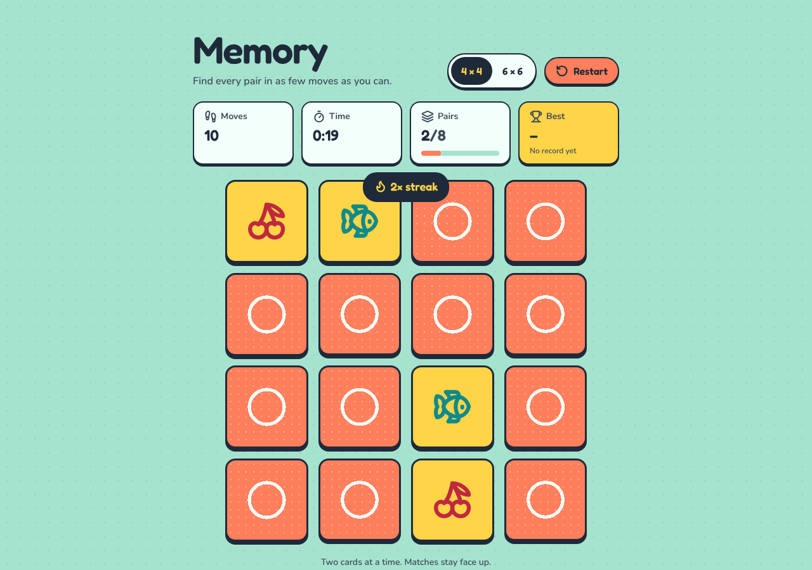
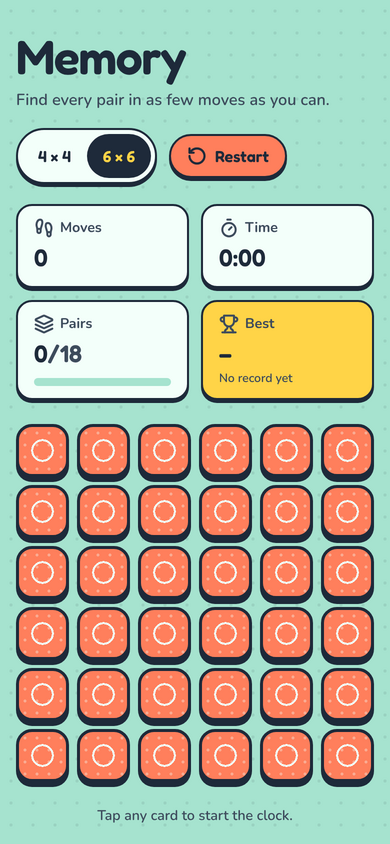

<div align="center">

# 🧠 Memory Game

A card-matching (Concentration) game built with Next.js, React and Tailwind CSS. Flip cards, find the pairs, and beat your best score in as few moves as possible.


&nbsp;

</div>

---

## Features

- **Two board sizes:** 4×4 (8 pairs) and 6×6 (18 pairs), switchable at any time
- **Fair shuffle:** cards are shuffled with the Fisher–Yates algorithm at the start of every game
- **Toy-box design:** chunky, outlined game pieces on a mint tabletop, 18 colourful SVG icon pairs (no emoji, so it looks the same on every device)
- **3D flip animation:** cards flip in 3D; matched pairs turn yellow and stay face up
- **Move counter, timer and pair progress:** the timer starts on your first flip
- **Combo streaks:** a "combo" badge pops up when you find several pairs in a row
- **Best score per board size:** your lowest move count is saved in `localStorage`
- **Win screen:** final moves and time, a 1–3 star rating based on the board size, and a note when you set a new best score
- **Restart** button and a fully responsive layout; on laptops the whole board always fits on screen
- **Accessible:** keyboard play with visible focus, screen-reader labels for every card, live streak announcements, and reduced-motion support

## How to play

1. Choose **4x4** or **6x6** in the top-right corner.
2. Click a card to flip it, then click a second card.
3. If the two cards match, they stay open. If not, they flip back after one second.
4. Every pair of flips counts as one move. Match all pairs to win.

**Star rating** (moves ÷ number of pairs):

| Rating | Moves per pair |
|---|---|
| ⭐⭐⭐ Perfect Memory! | 1.5 or fewer |
| ⭐⭐ Great Job! | 2.5 or fewer |
| ⭐ Keep Practicing! | more than 2.5 |

## Tech stack

| Layer | Tools |
|---|---|
| Framework | Next.js 16 (App Router), React 19 |
| Language | TypeScript |
| Styling | Tailwind CSS 4, Lucide icons, Fredoka + Nunito (self-hosted via Fontsource) |
| State | React hooks (`useState`, `useEffect`, `useCallback`, `useRef`) |
| Storage | Browser `localStorage` |

No backend or API keys needed.

## Getting started

**Requirements:** Node.js 18.18 or newer.

```bash
git clone https://github.com/ZainAftab-dev/Memory-Game.git
cd Memory-Game
npm install
npm run dev
```

Open [http://localhost:3000](http://localhost:3000).

For a production build: `npm run build` then `npm start`.

## Project structure

```
app/
├── layout.tsx              # root layout and page metadata
├── page.tsx                # renders <MemoryGame />
└── globals.css             # Tailwind theme and 3D flip utilities
components/
├── memory-game.tsx         # game state: shuffle, flips, matching, timer, combos, best score
├── card.tsx                # one card with front/back faces and flip animation
├── header.tsx              # title, board-size switch, restart, moves/time/pairs/best
├── game-over-modal.tsx     # win screen with stars and stats
└── ui/                     # shadcn/ui components
```

## Deployment

The app is a standard Next.js project. Import the repository into [Vercel](https://vercel.com/new) and deploy with the default settings; no environment variables are required.

## Author

**Zain Aftab** · [GitHub](https://github.com/ZainAftab-dev) · [LinkedIn](https://www.linkedin.com/in/zain-aftab-563727295/)

## License

[MIT](LICENSE)
